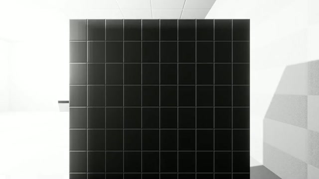
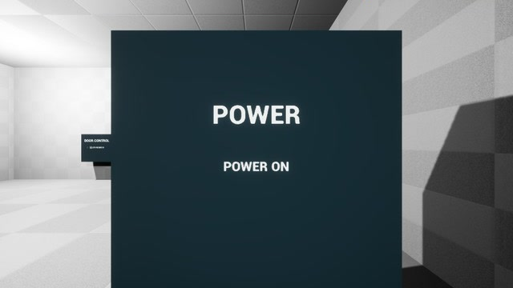

# Unreal Engine 5 Technical QA Lab

An Unreal Engine 5 prototype for testing Blueprint interactions, triggers, and state transitions through functional and exploratory testing.

## Case study — Making the control room terminals readable

All four gameplay tests passed in RUN-001. Watching the recording revealed a problem the logs could not show. From the player's interaction point, the power terminal looked like a dark block. Pressing **E** switched the power on, but the terminal face gave the player no readable confirmation.

| Before · RUN-001 | After · RUN-002 |
| --- | --- |
|  |  |

**Reproduce.** Start a fresh session in the [baseline build](https://github.com/ornellasdev/Unreal-Engine-5-Technical-QA-Lab/tree/f9c5d853db169e359626f05fd0f29d1ce0a5f5f5). Approach the power terminal and press **E**. From that position, check whether you can identify the terminal and tell whether the room now has power. The left image is the player viewport at 2.6 seconds in the [original gameplay clip](qa/runs/RUN-001/control-room.mp4).

**Fix.** I moved the labels onto the terminal faces, used light text on dark panels, and wired the displayed messages to the Blueprint state changes. The power prompt now changes from **[E] SWITCH ON** to **POWER ON**. I also adjusted the room lighting and gave the security door a blue finish so its edges stand out against the wall.

**Retest.** In RUN-002, player-view captures showed both power states and the door's **OFFLINE - NO POWER** response. All four functional cases passed again, including collision at the closed door and passage after opening. [Visual retest and regression results](qa/runs/RUN-002/README.md)

## Play the current build

Open `ControlRoomLab.uproject` in Unreal Engine 5.9 Preview 2 and press **Play**. Use **WASD** to move and the **mouse** to look. Approach the **DOOR CONTROL** terminal and press **E**. The terminal displays **OFFLINE - NO POWER** and the closed door blocks the player. Press **E** beside **POWER** to switch the room power on. After you leave, the power stays on for the rest of the session. Return to **DOOR CONTROL** and press **E**. The door rises over one second. Once it is open, walk through the doorway.

## First scenario — Control room security door

The player starts in a control room with the power off and the security door closed. One terminal turns on the power. A second terminal controls the door. Leaving either terminal's interaction range preserves the power state. The door accepts an open command only while the player is within range of the door terminal and the power is on.

An accepted command moves the door from **Closed** to **Opening** to **Open**. Further inputs during opening have no effect. Once open, the doorway must allow the player to walk through.

## Functional tests

Start each case in a fresh play session. The first four cases cover door behavior and collision. TC-005 checks the edge of the terminal's interaction range. TC-006 checks collision while the panel rises.

| ID | Player actions | Expected result |
| --- | --- | --- |
| TC-001 | Leave the power off. Approach the door terminal and interact. | The terminal indicates that power is unavailable. The door stays closed and blocks passage. |
| TC-002 | Switch on the power. Approach the door terminal, leave its range, then press interact. | Power stays on. The open command is unavailable outside the terminal's range, and the door stays closed. |
| TC-003 | Switch on the power. Enter the door terminal's range, step out, then return and interact once. | The door begins opening, reaches Open, and lets the player walk through. |
| TC-004 | Switch on the power and activate the door terminal. Press interact several more times while the door is moving, then walk through. | The opening animation finishes once without restarting. The door stays open and the player can pass. |
| TC-005 | Power the room. With the player centered at Y = −140 cm and Z = 95 cm, press E at X = −2 cm, then again at X = 0 cm. | The outside input leaves the door closed. The inside input starts one opening and the player can pass. |
| TC-006 | Power the room, hold W against the door and press E at the edge of the terminal zone. Keep W held as the panel lifts. | The low panel blocks movement. As clearance increases, the player passes underneath without needing to release W. |

### Run the functional regression

From the repository root, run the following command with Python 3 and your local Unreal Engine 5.9 Preview 2 Linux editor binary. If `UnrealEditor-Cmd` is on your PATH, omit `--editor` and its value.

```bash
python3 qa/run_functional.py --editor "/path/to/Engine/Binaries/Linux/UnrealEditor-Cmd"
```

The runner starts one headless game per case and checks Blueprint messages, power, door transitions and player collision. It prints a result for each case and returns a nonzero exit code on failure. Each execution keeps its Unreal logs in a new directory under `Saved/QA/`. For the rendered readability check, see the [RUN-002 screenshots](qa/runs/RUN-002/README.md).

### Run the native Blueprint test in the editor

Open **Session Frontend → Automation** and search for **UnpoweredDoor**. Select the test under **Project → Functional Tests → Maps → ControlRoom** and run it. Its Functional Test Actor moves the pawn to the door terminal, sends E and checks the text displayed by the gameplay Blueprint and the door state. [Blueprint asset](Content/Tests/BP_FT_UnpoweredDoor.uasset) · [RUN-008 result and command line](qa/runs/RUN-008/README.md)

### Test the log verifier

The local gameplay suite above launches six Unreal sessions. The **QA log verifier** workflow runs five Python unit tests on every pull request and on pushes to `main`. These tests replay excerpts from the TC-001 and TC-004 logs recorded during RUN-006. Two positive controls check that the verifier accepts the original evidence. Three negative controls change one observation at a time and require a failure for the expected reason.

| Change to the recorded log | What the verifier must detect |
| --- | --- |
| Duplicate the opening event | The door started opening twice. |
| Remove one of two player-position samples | Evidence for the blocked player is incomplete. |
| Move the second player position past the closed door | The player crossed while the door was still closed. |

From the repository root, run the same checks with Python 3:

```bash
python3 -B -m unittest discover -s qa/tests -v
```

[Verifier tests](qa/tests/test_verifier.py) · [GitHub Actions runs](https://github.com/ornellasdev/Unreal-Engine-5-Technical-QA-Lab/actions/workflows/qa-verifier.yml)

## Test runs and evidence

| Run | Question | Result |
| --- | --- | --- |
| [RUN-001 · Gameplay baseline](qa/runs/RUN-001/README.md) | Do power, range, repeated input and door collision work as specified? | Four functional cases passed. The gameplay clip revealed poor contrast at the terminals and door. |
| [RUN-002 · Visual retest](qa/runs/RUN-002/README.md) | Can the player distinguish the closed door and read the terminal feedback? | Player-view captures verified the fix. All four functional cases passed again. |
| [RUN-003 · Exploratory testing](qa/runs/RUN-003/README.md) | Do terminal feedback, door motion and collision stay consistent across re-entry and a new session? | The door opened once despite repeated input. A fresh session restored the starting prompts, power state and blocked passage. |
| [RUN-004 · Repeatable regression](qa/runs/RUN-004/README.md) | Can one local command run and check all four cases? | Four fresh Unreal processes completed and all four cases passed. |
| [RUN-005 · Terminal range boundary](qa/runs/RUN-005/README.md) | Does moving the player center 2 cm across the trigger boundary change the result of pressing E? | The outside input left the door closed. The inside input opened it. All five cases passed locally. |
| [RUN-006 · Moving door collision](qa/runs/RUN-006/README.md) | What happens when the player keeps pushing against the panel as it lifts? | The player cleared the moving door before opening finished. All six cases passed locally. |
| [RUN-007 · Simulation-rate comparison](qa/runs/RUN-007/README.md) | Does changing the fixed step affect contact and passage under the moving door? | TC-006 passed at 30, 60 and 120 fps. Full clearance took 0.617–0.633 simulated seconds after opening began. |
| [RUN-008 · Native Blueprint functional test](qa/runs/RUN-008/README.md) | Does the actual terminal show the offline warning and keep the unpowered door closed after E? | Unreal Automation discovered the actor in ControlRoom and reported Success. |
