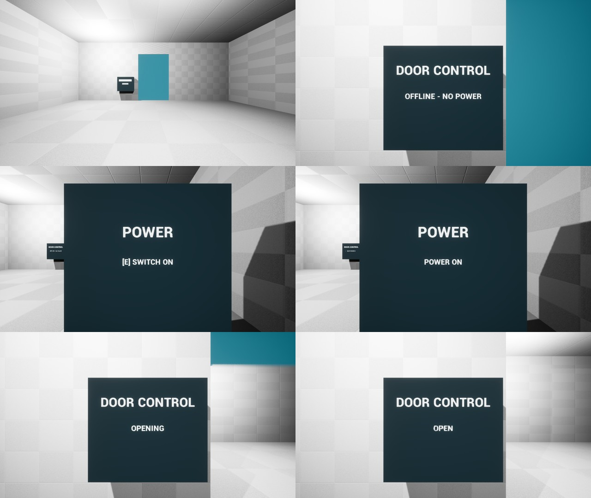

# RUN-002 — Terminal readability and security door regression

On November 25, 2026, the [RUN-001 visual finding](../RUN-001/README.md#visual-review) passed its retest in Unreal Engine 5.9.0 Preview 2 on Linux. This run uses the map, Blueprint, materials, and rendering configuration published with this report.

### Player-view retest

The Vulkan capture used a 960 × 540 player viewport. From the spawn position, the blue door panel stands out against the pale surround. At the door terminal, pressing E before restoring power changes the interaction prompt to **OFFLINE - NO POWER**. At the power terminal, **[E] SWITCH ON** changes to **POWER ON**. Back at the door, **[E] OPEN DOOR** changes to **OPENING** and then **OPEN** as the panel rises. The messages appear on the terminal faces and persist until the corresponding state changes.

The six frames below show the closed door from spawn, the offline warning, the power terminal before and after activation, and the door terminal during and after opening. The harness repositioned the player between viewpoints and sent the interaction key in game.

### Functional regression

Each case ran in a fresh standalone game process at 30 simulated frames per second. The assertions used Blueprint state, message counts and player collision positions. [Case steps](../../../README.md#functional-tests) · [Selected runtime observations](runtime.txt)

| Case | Result | Observation |
| --- | --- | --- |
| TC-001 | Pass | The unpowered interaction produced the warning. The door remained closed and stopped the player at X = 176.55 cm. |
| TC-002 | Pass | Outside the door terminal's range, the interaction produced no door response. Power stayed on, and the closed door blocked passage. |
| TC-003 | Pass | Returning and pressing E started one opening. The player crossed the door plane at X = 220 cm and reached X = 454.55 cm. |
| TC-004 | Pass | Three additional presses during opening produced a single completion on frame 60, the same as TC-003. The player crossed the doorway. |

The [RUN-003 exploratory report](../RUN-003/README.md) follows the same build through terminal re-entry, repeated inputs after opening and a fresh game session.
